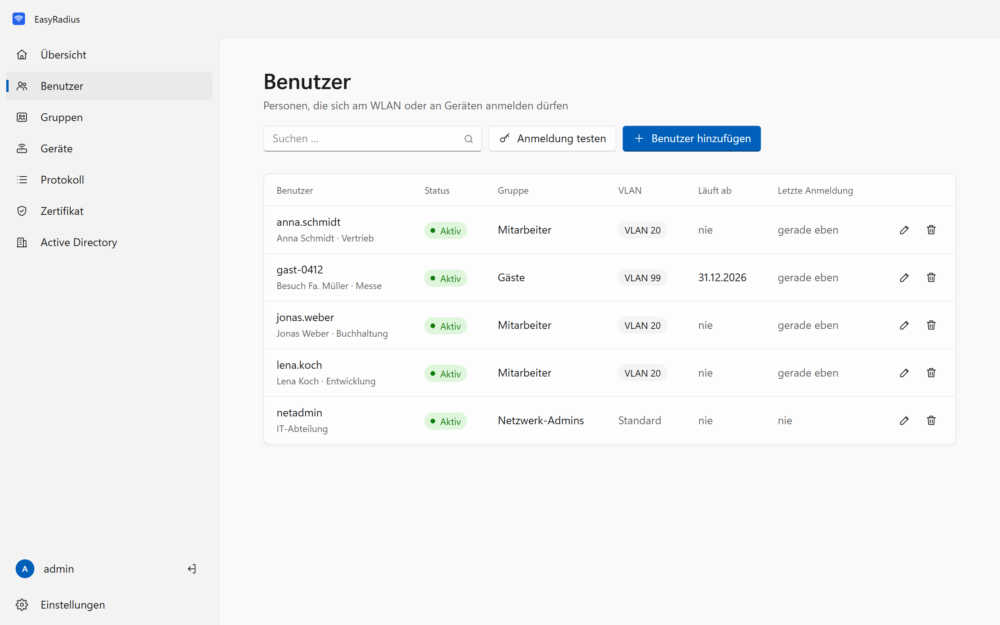
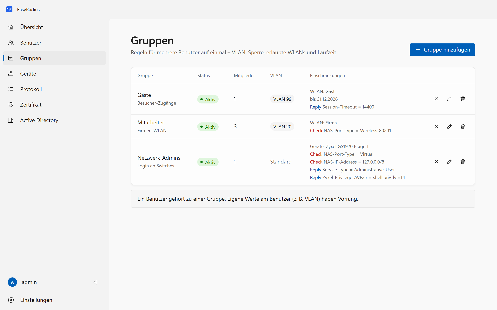
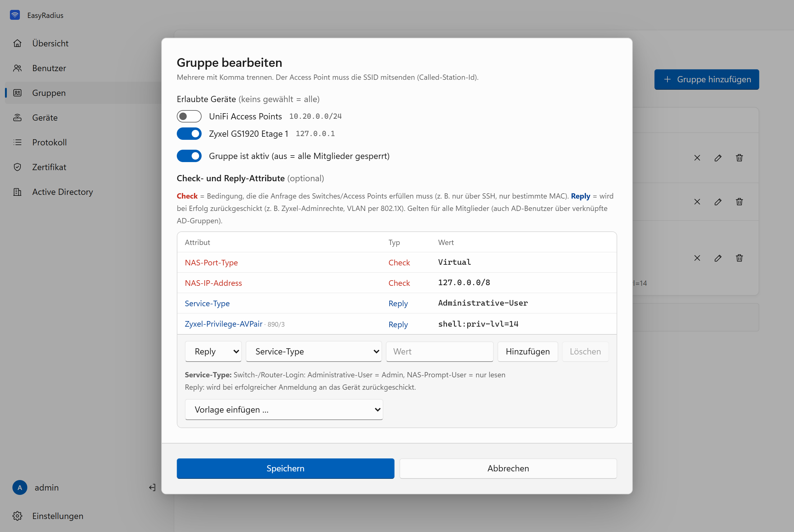
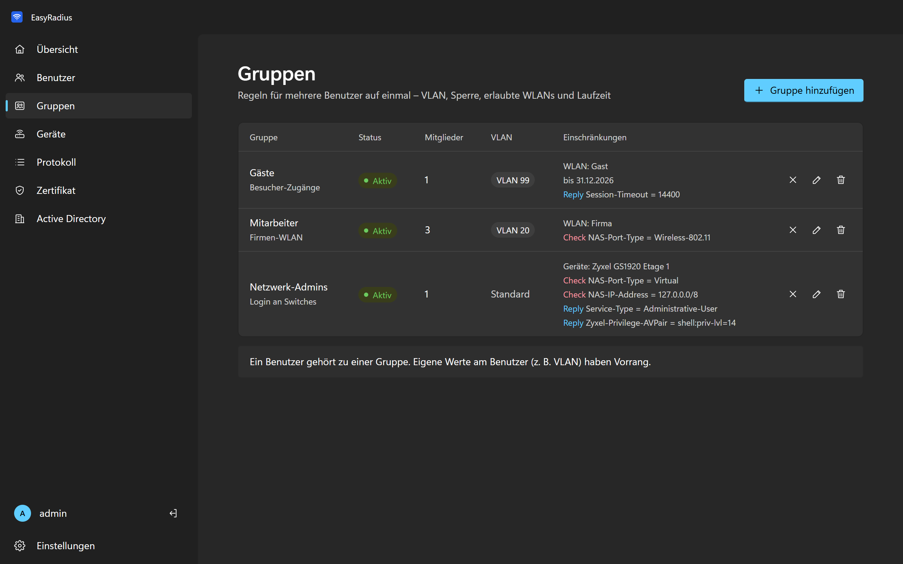
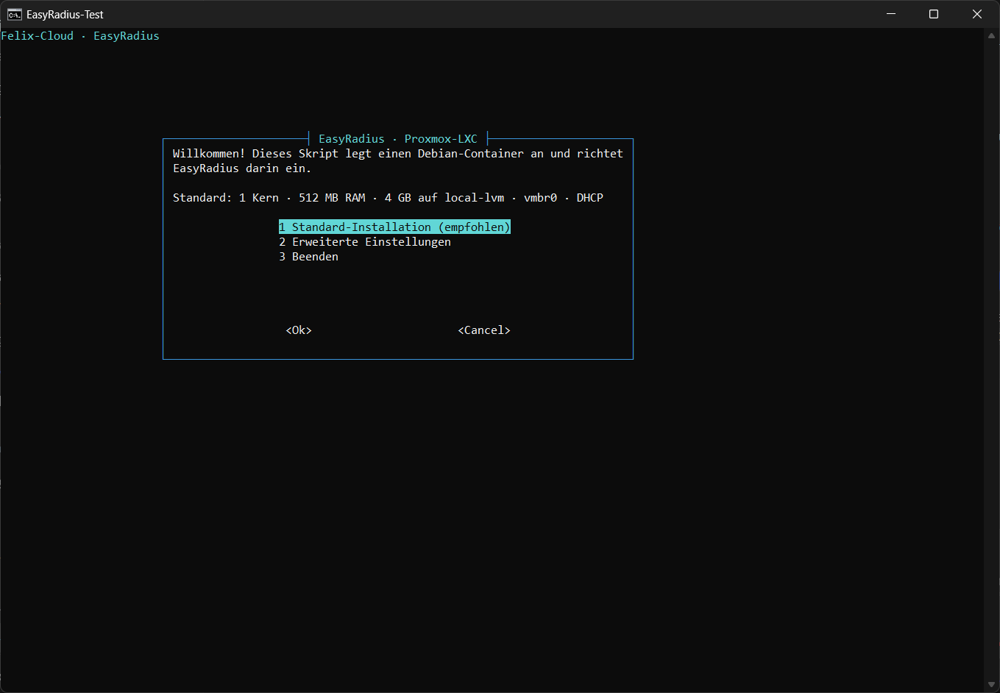
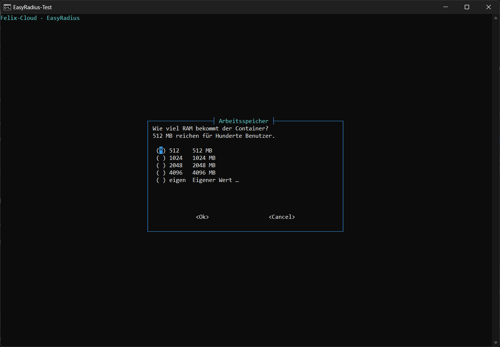
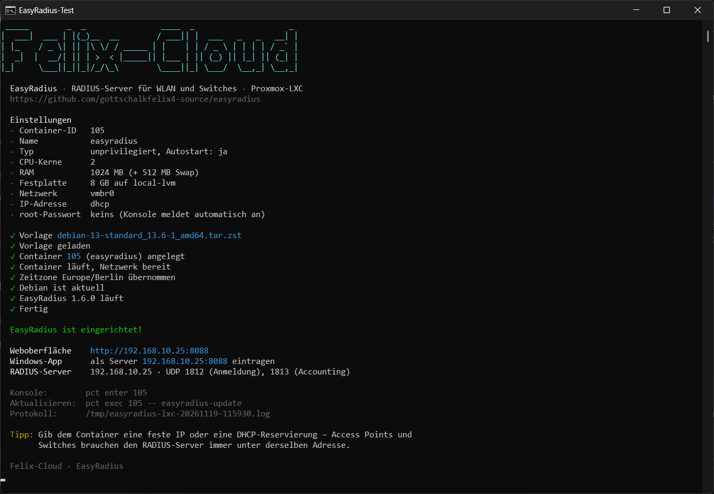
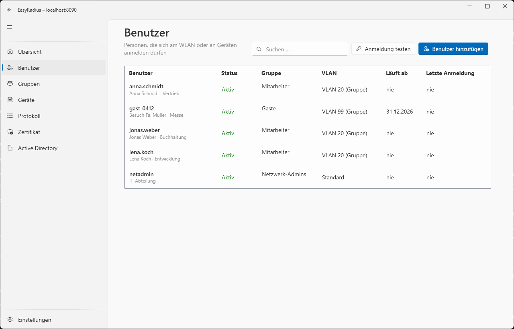
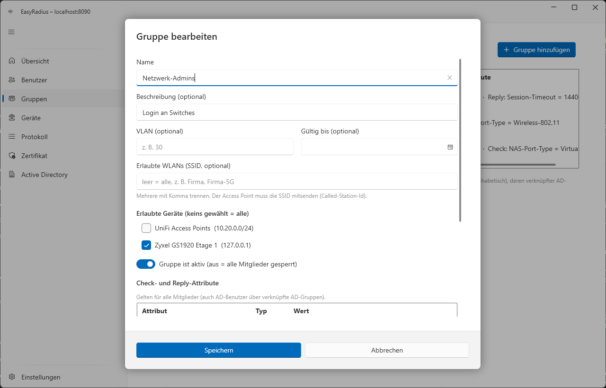
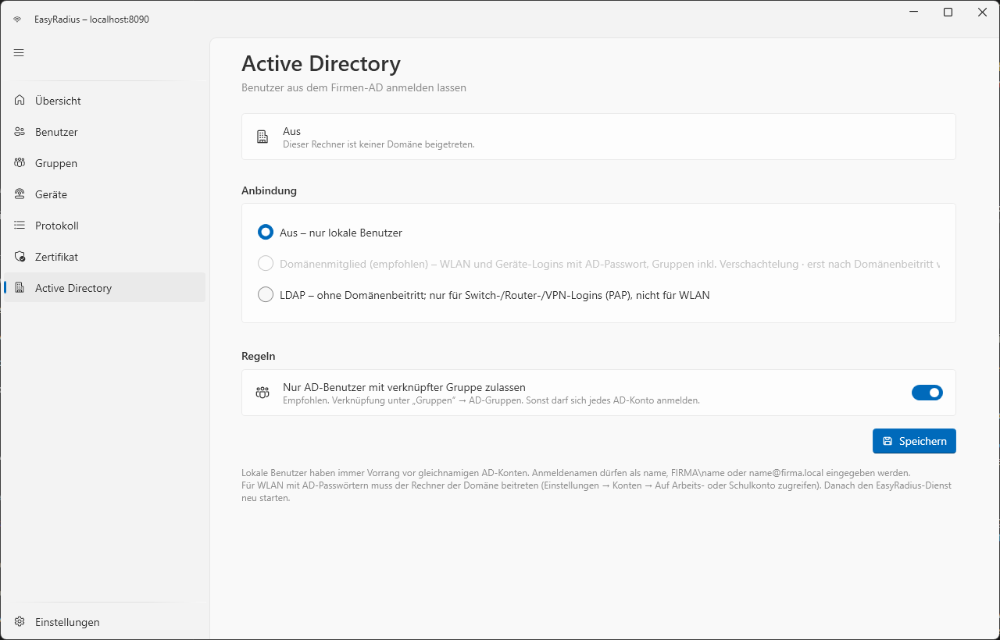

<p align="center">
  
</p>

<h1 align="center">EasyRadius</h1>

<p align="center">
  RADIUS-Server für Windows und Linux – für WPA2/WPA3-Enterprise-WLAN und den Login an Switches.<br>
  Verwaltung per Windows-App oder im Browser. MSI für Windows, Einzeiler für Proxmox-LXC.
</p>

<p align="center">
  <a href="../../releases/latest"><b>Download</b></a> ·
  <a href="#installation">Installation</a> ·
  <a href="#proxmox-lxc">Proxmox</a> ·
  <a href="#windows-app-und-weboberfläche">Windows-App</a> ·
  <a href="#gruppen-check--und-reply-attribute">Attribute</a> ·
  <a href="#active-directory">Active Directory</a> ·
  <a href="#selbst-bauen">Selbst bauen</a>
</p>


## Worum es geht

Wer im Büro oder zu Hause WLAN mit eigenem Passwort pro Person haben will, braucht einen RADIUS-Server.
Die üblichen Kandidaten sind FreeRADIUS (Textdateien, Linux) oder Microsofts NPS (Windows Server, viele
Dialoge, Rollen, Richtlinien). EasyRadius ist der Versuch, das auf das Nötige zu reduzieren:
MSI installieren, im Browser einen Access Point und ein paar Benutzer anlegen, fertig.

Verwaltet wird über eine Windows-App im Stil von Windows 11 oder – von jedem anderen Rechner im Netz – über
die Weboberfläche. Beide können dasselbe. Alles ist auf Deutsch.

## Funktionen

- **WLAN-Enterprise** mit PEAP-MSCHAPv2 – funktioniert mit Windows, Android, iOS, macOS und Linux;
  zusätzlich EAP-TTLS (PAP oder MS-CHAPv2) und auf Wunsch EAP-TLS mit Benutzerzertifikaten
- **Switch-, Router- und VPN-Logins** per PAP oder MS-CHAPv2
- **MAC-Adressen** für Drucker, Telefone und Kameras ohne 802.1X (MAC Authentication Bypass)
- **Gruppen** mit VLAN, Sperre, Ablaufdatum und Beschränkung auf bestimmte WLANs (SSID) oder Geräte
- **Check- und Reply-Attribute** pro Benutzer und Gruppe, nach dem Vorbild von TekRADIUS – inklusive
  Herstellerattributen (Zyxel, Cisco, MikroTik, Aruba, Fortinet, Juniper, WISPr) und eigener VSAs
- **Active Directory** als Domänenmitglied (wie NPS) oder per LDAP, mit Zuordnung von AD-Gruppen
- **Zertifikate**: eigene CA wird automatisch erzeugt; alternativ Let's Encrypt für die eigene Domain
  (49 DNS-Anbieter per API, jeder andere per einmaligem CNAME-Eintrag oder über Port 80)
- **Einrichtungsseite für Endgeräte** mit QR-Code – das Handy zeigt die passenden Schritte für sein System
- **Live-Protokoll** mit verständlichen Gründen, warum eine Anmeldung abgelehnt wurde, und einem
  Änderungsprotokoll: wer hat wann was umgestellt
- **Accounting**: wer gerade verbunden ist, abgeschlossene Sitzungen pro Monat (auch als CSV), Trennen
  einer Sitzung per Disconnect-Request (RFC 5176)
- **Sperre nach Fehlversuchen** pro Benutzer und pro Endgerät
- **Mehrere Administratoren** mit den Rollen *Administrator* und *Nur lesen*, dazu API-Tokens für Skripte
- **Sicherung** der kompletten Konfiguration samt Zertifikaten als verschlüsselte Datei; Benutzer und
  MAC-Adressen als CSV importieren und exportieren
- **Windows-App** (WPF, Fluent-Design, Mica) und **Weboberfläche** mit gleichem Funktionsumfang; die App
  kann auch einen EasyRadius auf einem anderen Rechner verwalten
- Läuft als **Windows-Dienst** oder unter **Linux** (systemd) – als **Proxmox-LXC** mit einem Befehl eingerichtet
- Daten in einer JSON-Datei, keine Datenbank

| | |
|---|---|
|  |  |
|  |  |
|  |  |

## Installation

### Windows

1. `EasyRadius-<Version>.msi` aus den [Releases](../../releases/latest) herunterladen und ausführen.
2. Die Verwaltung startet automatisch – dort einen Administrator anlegen.
3. Unter **Geräte** den Access Point oder Switch mit seiner IP-Adresse freigeben. Ein Shared Secret wird
   vorgeschlagen.
4. Unter **Benutzer** die ersten Konten anlegen.

Der Installer richtet den Dienst *EasyRadius RADIUS-Server* ein (Autostart, Neustart bei Absturz) sowie
Firewall-Regeln für UDP 1812/1813 und TCP 8088/8443 (Weboberfläche). Die Regeln gelten nur für
`EasyRadius.exe` und nur in privaten und Domänen-Netzwerken. Wer Let's Encrypt über Port 80 nutzt, gibt
TCP 80 selbst frei. Im Startmenü stehen „EasyRadius“ (Windows-App) und „EasyRadius Weboberfläche“.
Meldungen des Dienstes erscheinen auch in der Windows-Ereignisanzeige (Quelle *EasyRadius*).

Das Installationspaket ist rund 70 MB groß, weil die Windows-App ihre .NET-Laufzeit mitbringt – auf dem
Rechner muss nichts zusätzlich installiert sein.

Voraussetzung: Windows 10/11 oder Windows Server 2016 und neuer, 64 Bit.

### Proxmox (LXC)

Auf dem Proxmox-Host in der Shell (als root):

```bash
bash -c "$(curl -fsSL https://raw.githubusercontent.com/gottschalkfelix4-source/easyradius/main/proxmox/easyradius-lxc.sh)"
```

Im Startmenü gibt es zwei Wege: **Standard-Installation** mit sinnvollen Vorgaben oder **Erweiterte
Einstellungen**. Dort führen Auswahllisten durch CPU-Kerne, Arbeitsspeicher, Swap und Festplatte (jeweils mit
Vorschlägen und „Eigener Wert“), Speicher mit freiem Platz, Bridge, VLAN, DHCP oder feste IP mit Gateway und
DNS, Containertyp, root-Passwort und Autostart. Danach lädt das Skript die aktuelle Debian-Vorlage, legt den
Container an, bringt Debian auf den neuesten Stand und installiert EasyRadius als Dienst. Ohne root-Passwort
meldet die Proxmox-Konsole automatisch an. Schlägt ein Schritt fehl, nennt das Skript ihn, zeigt das Protokoll
und bietet an, den halb angelegten Container wieder zu entfernen.

| | | |
|---|---|---|
|  |  |  |

| Einstellung | Vorgabe | Auswahl im erweiterten Modus |
|---|---|---|
| Container-ID | nächste freie | frei wählbar |
| Name | `easyradius` | frei wählbar |
| CPU-Kerne | 1 | 1, 2, 4 oder eigener Wert |
| RAM / Swap | 512 MB / 512 MB | 512 – 4096 MB bzw. 0 – 1024 MB oder eigener Wert |
| Festplatte | 4 GB auf `local-lvm` | 4, 8, 16, 32 GB oder eigener Wert; Speicher aus der Liste |
| Netzwerk | `vmbr0`, DHCP | Bridge aus der Liste, VLAN-Tag, feste IP mit Gateway und DNS |
| System | Debian 13, unprivilegiert, Autostart | privilegiert, ohne Autostart, root-Passwort |

Das Farbschema der Dialoge lässt sich über die Variable `NEWT_COLORS` ändern.

Ohne Rückfragen, z. B. mit fester IP:

```bash
CTID=150 CT_IP=192.168.1.20/24 CT_GW=192.168.1.1 EASYRADIUS_YES=1 \
  bash -c "$(curl -fsSL https://raw.githubusercontent.com/gottschalkfelix4-source/easyradius/main/proxmox/easyradius-lxc.sh)"
```

Weitere Variablen: `CT_HOSTNAME`, `CT_CORES`, `CT_RAM`, `CT_SWAP`, `CT_DISK`, `CT_STORAGE`, `CT_BRIDGE`, `CT_VLAN`,
`CT_DNS`, `CT_PASSWORD`, `CT_UNPRIVILEGED`, `CT_ONBOOT`, `EASYRADIUS_VERSION`.

Aktualisieren: `pct exec <ID> -- easyradius-update`

### Debian, Ubuntu und andere Linux-Systeme mit systemd

```bash
curl -fsSL https://raw.githubusercontent.com/gottschalkfelix4-source/easyradius/main/linux/install.sh | sudo bash
```

Installiert nach `/usr/local/bin`, legt den Dienst `easyradius` an (eigener Systembenutzer, abgesichert) und
speichert die Daten in `/var/lib/easyradius`. Ein erneuter Aufruf – oder `easyradius-update` – aktualisiert.
Vor jedem Update sichert das Skript die Daten nach `/var/lib/easyradius.bak-<Zeitpunkt>.tar.gz` (die drei
neuesten bleiben). Startet die neue Version nicht, kommt automatisch die alte zurück.
Optionen: `--version 1.7.0`, `--file paket.tar.gz` (ohne Internet), `--uninstall` (Daten bleiben),
`--uninstall --purge`. Pakete gibt es für amd64 und arm64.

## Windows-App und Weboberfläche

Die **Windows-App** („EasyRadius“ im Startmenü) ist der bequemste Weg auf dem Server selbst. Beim Anmelden
lässt sich aber auch die Adresse eines anderen EasyRadius eintragen – die App funktioniert dann als
Verwaltungskonsole von einem Arbeitsplatz aus. Das Passwort kann sie, mit Windows verschlüsselt, für den
angemeldeten Windows-Benutzer speichern.

Die **Weboberfläche** unter `https://<server>:8443` ist für alles andere da: ein Rechner ohne App, ein Mac,
ein Tablet – und der Normalfall, wenn EasyRadius in einem Proxmox-Container läuft (die Windows-App kann ihn
ebenso verwalten). Unter *Einstellungen → Fernzugriff* zeigt die App, unter welchen Adressen sie erreichbar ist.

HTTPS nutzt dasselbe Zertifikat wie RADIUS. Mit der eigenen CA warnt der Browser beim ersten Aufruf; mit
Let's Encrypt nicht. Die Windows-App zeigt beim ersten Verbinden den Fingerabdruck an und merkt ihn sich –
ändert sich das Zertifikat später unerwartet, verweigert sie die Verbindung. `http://<server>:8088` bleibt
erreichbar; in den Einstellungen lässt sich HTTP aus dem Netz abschalten (vom Server selbst und für die
Einrichtungsseite der Handys bleibt es offen).

Konten gibt es mit zwei Rollen: **Administrator** darf alles, **Nur lesen** sieht alles außer Shared Secrets
und kann nichts ändern. Für Skripte gibt es **API-Tokens** (*Konten → API-Tokens*):

```bash
curl -H "Authorization: Bearer er_…" https://radius.firma.local:8443/api/users
```

Unter *Einstellungen → Sicherung* lädt man die komplette Konfiguration samt Zertifikaten als
`.erbackup`-Datei herunter. Sie ist mit einem eigenen Passwort verschlüsselt und lässt sich auf einem
anderen Rechner wiederherstellen – auch zwischen Windows und Linux.

| | |
|---|---|
|  |  |
|  |  |

## Access Point oder Switch einrichten

| Einstellung | Wert |
|---|---|
| Sicherheit | WPA2-Enterprise oder WPA3-Enterprise (bzw. 802.1X am Switch-Port) |
| RADIUS-Server | IP-Adresse des Windows-Rechners |
| Port | 1812, Accounting 1813 |
| Shared Secret | wie in EasyRadius beim Gerät hinterlegt |
| Message-Authenticator | einschalten, falls das Gerät die Option hat |
| CoA / Dynamic Authorization | optional, Port 3799 – nötig für „Sitzung trennen“ |

Kommt eine Anfrage von einem Gerät, das noch nicht freigegeben ist, zeigt die Übersicht das an – mit einem
Knopf zum Freigeben.

Neue Geräte verlangen den Message-Authenticator in jeder Anfrage. Das schützt vor dem Blast-RADIUS-Angriff
(CVE-2024-3596). Ältere Switches, die ihn bei PAP nicht mitschicken, werden dann abgewiesen – das Protokoll
sagt das deutlich. Dann am Gerät die Option suchen oder in EasyRadius beim Gerät den Haken
„Message-Authenticator verlangen“ entfernen. Geräte aus Versionen vor 1.7 behalten das bisherige Verhalten.

## MAC-Adressen (MAB)

Drucker, Telefone oder Kameras können oft kein 802.1X. Der Switch schickt dann ihre MAC-Adresse als
Benutzername. Unter **MAC-Adressen** werden solche Geräte eingetragen, mit Gruppe, VLAN und Attributen wie
bei Benutzern. Die Schreibweise ist egal (`AA:BB:…`, `aabb.cc…`, `AA-BB-…`). Am Switch heißt die Funktion
meist *MAC Authentication*, *MAB* oder *MAC-based authentication*.

MAB ist kein Schutz gegen jemanden, der eine MAC-Adresse fälscht – solche Geräte gehören in ein eigenes
VLAN mit wenig Rechten.

## Endgeräte verbinden

Methode **PEAP**, Phase 2 **MSCHAPv2**, Benutzername und Passwort. Windows, iOS und macOS fragen beim ersten
Verbinden, ob sie dem Zertifikat vertrauen sollen. **EAP-TTLS** mit PAP oder MSCHAPv2 geht ebenfalls (in den
Einstellungen abschaltbar) – manche Linux- und Android-Profile wählen das von sich aus.

**EAP-TLS** (ohne Passwort, mit Zertifikat pro Benutzer) wird in den Einstellungen eingeschaltet. Beim
Benutzer stellt man dann ein Zertifikat aus und bekommt eine passwortgeschützte `.p12`-Datei für das Gerät.
Das funktioniert nur mit der eigenen CA, nicht mit Let's Encrypt. Gesperrte Zertifikate werden sofort
abgelehnt.

**Android 11 und neuer** verlangt eine Zertifikatsprüfung. Zwei Möglichkeiten:

- **Mit eigener Domain und Let's Encrypt:** am Handy „Systemzertifikate verwenden“ und die Domain eintragen.
  Nichts zu installieren.
- **Ohne Domain:** CA-Zertifikat über die Einrichtungsseite herunterladen, als WLAN-Zertifikat
  installieren, Domain eintragen.

Die Einrichtungsseite (`http://<server>:8088/einrichten`, als QR-Code unter **Zertifikat**) führt durch
beide Fälle und erkennt das Betriebssystem des Handys.

## Gruppen, Check- und Reply-Attribute

Ein Benutzer gehört zu einer Gruppe. Die Gruppe legt VLAN, Laufzeit, erlaubte WLANs und Geräte fest – ein
Klick sperrt alle Mitglieder.

Dazu kommen Attribute nach dem Muster von TekRADIUS, als Liste *Attribut · Typ · Wert*:

| Typ | Bedeutung | Beispiele |
|---|---|---|
| **Check** | Bedingung an die Anfrage des Geräts. Passt sie nicht, wird abgelehnt. | `NAS-Port-Type = Virtual` (nur SSH/Web-Login), `Calling-Station-Id = AA-BB-*`, `NAS-IP-Address = 10.0.0.0/24`, `Called-Station-Id = *:Firma` |
| **Reply** | Wird bei Erfolg an das Gerät zurückgeschickt. | `Service-Type = Administrative-User`, `Zyxel-Privilege-AVPair = shell:priv-lvl=14`, `Session-Timeout = 28800` |

Check-Werte verstehen `*` und `?` als Platzhalter, Netze in CIDR-Schreibweise und `!` für „darf nicht“.
Gruppenattribute gelten für alle Mitglieder; ein Benutzerattribut gleichen Typs und Namens ersetzt das der
Gruppe. Vorlagen gibt es für 802.1X mit dynamischem VLAN, Zyxel (Admin/nur lesen), Cisco, HPE/Aruba und
MikroTik. Was nicht im Wörterbuch steht, lässt sich als eigenes Herstellerattribut (VSA) mit Hersteller-ID,
Nummer und Datentyp anlegen.

**Beispiel Zyxel-Switch:** Gruppe *Netzwerk-Admins* mit `NAS-Port-Type = Virtual` (Check) sowie
`Service-Type = Administrative-User` und `Zyxel-Privilege-AVPair = shell:priv-lvl=14` (Reply). Die
Privilegstufe bitte mit dem Handbuch des jeweiligen Modells abgleichen.

## Active Directory

| Modus | Voraussetzung | WLAN | Switch/VPN (PAP) |
|---|---|---|---|
| Domänenmitglied (nur Windows) | Der Rechner ist der Domäne beigetreten | ja (PEAP, TTLS) | ja |
| LDAP | Dienstkonto mit Leserechten | nur EAP-TTLS mit PAP | ja |

Im Domänenmodus prüft der Domänencontroller das Passwort, so wie bei NPS – EasyRadius sieht keine
Passwörter. AD-Gruppen (auch verschachtelte) werden mit EasyRadius-Gruppen verknüpft. Per LDAP geht WLAN
nur mit EAP-TTLS und PAP innen, weil MS-CHAPv2 ohne Domänenbeitritt nicht gegen das AD geprüft werden kann.
Das Passwort läuft dabei verschlüsselt im TLS-Tunnel zum Server; die Geräte müssen das Serverzertifikat
prüfen, sonst kann ein falscher Access Point Passwörter abgreifen.

Lokale Benutzer haben Vorrang vor gleichnamigen AD-Konten. Mit **Anmeldung testen** lässt sich prüfen,
welche Quelle, Gruppe und welches VLAN ein Konto bekommt und ob WLAN funktionieren würde.

## Let's Encrypt

Unter **Zertifikat → Let's Encrypt** gibt es drei Wege, die Domain zu bestätigen:

1. **DNS-Anbieter mit API** – u. a. IONOS, Hetzner, netcup, INWX, all-inkl, hosting.de, GoDaddy, OVH,
   Cloudflare, deSEC, DuckDNS. Die Zugangsfelder passen sich dem Anbieter an.
2. **Beliebiger Anbieter per CNAME** – einmalig einen CNAME-Eintrag anlegen (EasyRadius zeigt ihn an),
   danach läuft die Erneuerung über [acme-dns](https://github.com/joohoi/acme-dns) automatisch.
   Funktioniert z. B. auch mit Strato oder United Domains.
3. **Port 80** – wenn die Domain auf die öffentliche IP zeigt und Port 80 weitergeleitet ist.

Der RADIUS-Server selbst muss bei den DNS-Wegen nicht aus dem Internet erreichbar sein. Erneuert wird
30 Tage vor Ablauf. Die eigene CA bleibt erhalten, man kann jederzeit zurückwechseln.

## Daten und Sicherheit

- Daten liegen unter Windows in `C:\ProgramData\EasyRadius` (nur SYSTEM und Administratoren), unter Linux in
  `/var/lib/easyradius` (nur der Dienstbenutzer). Bei der Deinstallation bleiben sie erhalten.
- Shared Secrets, Passwort-Hashes und Zugangsdaten stehen verschlüsselt in der `config.json`. Der Schlüssel
  liegt in `secret.key` daneben, unter Windows zusätzlich per DPAPI an den Rechner gebunden. Wer den
  Datenordner auf einen anderen Rechner umziehen will, nimmt die Sicherung aus der Oberfläche.
- Gespeichert wird atomar mit Rückfallkopie (`config.json.bak`).
- Passwörter werden als NT-Hash gespeichert, weil MS-CHAPv2 ihn braucht. Die Passwörter der Oberfläche als
  bcrypt-Hash.
- Abgelehnte Geräte bekommen nur „Anmeldung abgelehnt“ zurück; den genauen Grund zeigt das Protokoll.
- Alle Antworten tragen einen Message-Authenticator an erster Stelle; EAP-Anfragen ohne gültigen werden
  verworfen.
- Nach zehn Fehlversuchen in 15 Minuten wird der Benutzer bzw. das Endgerät für 15 Minuten gesperrt
  (einstellbar). Aktive Sperren stehen unter **Sitzungen** und lassen sich dort aufheben.
- Sitzungen der Oberfläche enden nach zwei Stunden ohne Aktivität, spätestens nach zwölf. Ein neues Passwort
  meldet alle anderen Sitzungen des Kontos ab.

## Grenzen

- Kein CHAP (Passwörter liegen nicht im Klartext vor).
- MSI und App sind nicht signiert; Windows SmartScreen fragt deshalb beim ersten Start nach.
- Unter Linux gibt es Active Directory nur per LDAP – WLAN mit AD-Passwörtern dann nur über EAP-TTLS/PAP.
- Die AD-Anbindung im Domänenmodus ist bisher nur mit einem simulierten Verzeichnis automatisiert getestet,
  der Let's-Encrypt-Abruf noch nicht mit jedem DNS-Anbieter. Erfahrungsberichte aus echten Umgebungen sind
  willkommen – gerne als Issue.
- Die Oberflächen gibt es nur auf Deutsch.

## Selbst bauen

Voraussetzungen: Go 1.27 oder neuer und das .NET 8 SDK (für die Windows-App und WiX 5, das als lokales
Tool geladen wird).

```powershell
.\build.ps1 -Version 1.7.0
```

Ergebnis in `build\`: `EasyRadius.exe` (Dienst), `manager\EasyRadiusManager.exe` (Windows-App),
`EasyRadius-1.7.0.msi`, `radtest.exe` und die Linux-Pakete `easyradius-1.7.0-linux-amd64.tar.gz` / `-arm64`.
Zum Ausprobieren ohne Installation:

```powershell
.\build\EasyRadius.exe -data .\devdata
```

`radtest.exe` schickt Testanmeldungen an einen RADIUS-Server:

```powershell
.\build\radtest.exe -server 127.0.0.1:1812 -secret <secret> -user max -pass <passwort> -ssid Firma -porttype 19
```

| Pfad | Inhalt |
|---|---|
| `internal/radiusd` | RADIUS-Server, EAP/PEAP, Gruppenregeln, Accounting |
| `internal/auth` | PAP und MS-CHAPv2 |
| `internal/attrs` | Attribut-Wörterbuch, Check-Abgleich, Kodierung |
| `internal/directory` | Active Directory (LSA im Domänenmodus, LDAP) |
| `internal/letsencrypt` | ACME über [lego](https://github.com/go-acme/lego) |
| `internal/certs` | eigene CA und Serverzertifikat |
| `internal/store` | Benutzer, Gruppen, Geräte, Einstellungen |
| `internal/web` | Weboberfläche und API |
| `desktop/EasyRadius.Manager` | Windows-App (WPF, [WPF-UI](https://github.com/lepoco/wpfui)) |
| `installer/` | WiX-Installer |
| `linux/install.sh` | Installation/Update unter Linux (systemd) |
| `proxmox/easyradius-lxc.sh` | legt den Proxmox-LXC an |
| `tools/pack` | erzeugt die Linux-Pakete (tar.gz mit festen Rechten) |
| `tools/radtest` | Testclient |
| `tools/genproviders` | erzeugt die DNS-Anbieterliste aus lego |

## Lizenz

[MIT](LICENSE). Verwendete Bibliotheken: [layeh/radius](https://github.com/layeh/radius) (BSD-3),
[go-acme/lego](https://github.com/go-acme/lego) (MIT), [go-ldap](https://github.com/go-ldap/ldap) (MIT),
[rsc.io/qr](https://github.com/rsc/qr) (BSD-3), [golang.org/x](https://cs.opensource.google/go/x) (BSD-3),
[WPF-UI](https://github.com/lepoco/wpfui) (MIT).
