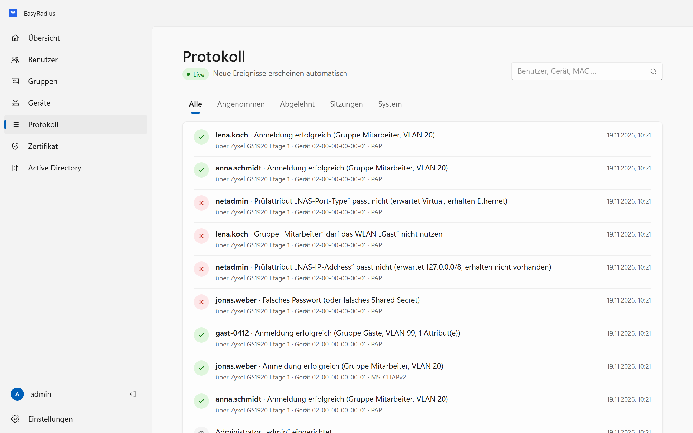
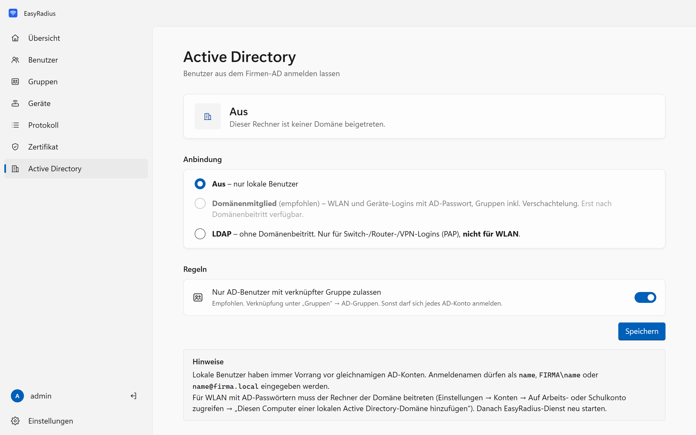
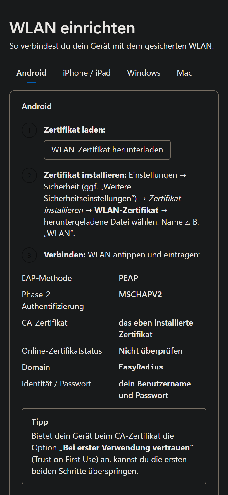
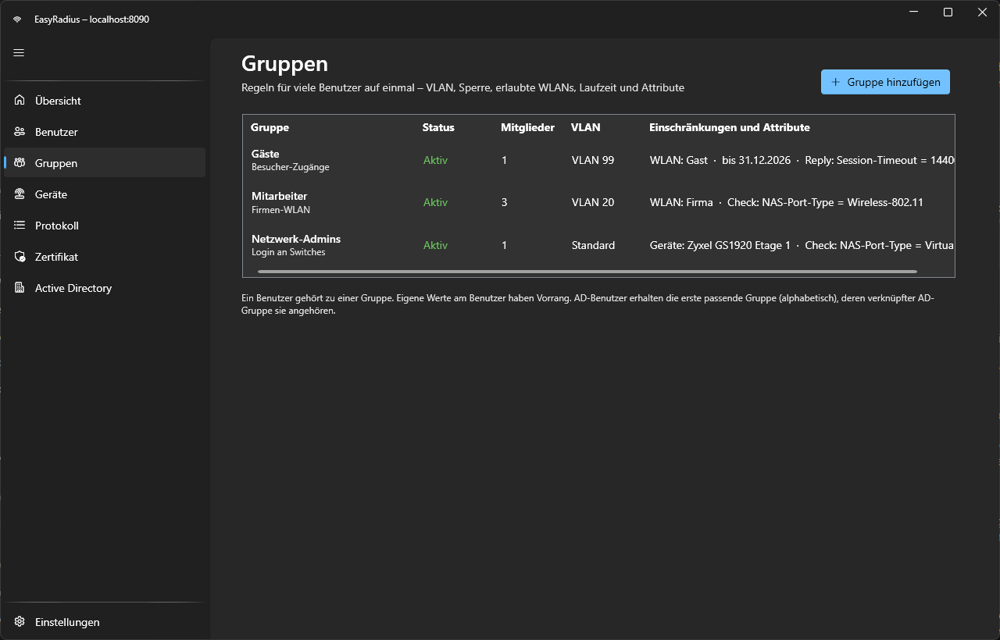

<p align="center">
  
</p>

<h1 align="center">EasyRadius</h1>

<p align="center">
  RADIUS-Server für Windows – für WPA2/WPA3-Enterprise-WLAN und den Login an Switches.<br>
  Verwaltung per Windows-App oder im Browser. Ein Installer, ein Dienst, keine Konfigurationsdateien.
</p>

<p align="center">
  <a href="../../releases/latest"><b>Download</b></a> ·
  <a href="#installation">Installation</a> ·
  <a href="#windows-app-und-weboberfläche">Windows-App</a> ·
  <a href="#gruppen-check--und-reply-attribute">Attribute</a> ·
  <a href="#active-directory">Active Directory</a> ·
  <a href="#selbst-bauen">Selbst bauen</a>
</p>



## Worum es geht

Wer im Büro oder zu Hause WLAN mit eigenem Passwort pro Person haben will, braucht einen RADIUS-Server.
Die üblichen Kandidaten sind FreeRADIUS (Textdateien, Linux) oder Microsofts NPS (Windows Server, viele
Dialoge, Rollen, Richtlinien). EasyRadius ist der Versuch, das auf das Nötige zu reduzieren:
MSI installieren, im Browser einen Access Point und ein paar Benutzer anlegen, fertig.

Verwaltet wird über eine Windows-App im Stil von Windows 11 oder – von jedem anderen Rechner im Netz – über
die Weboberfläche. Beide können dasselbe. Alles ist auf Deutsch.

## Funktionen

- **WLAN-Enterprise** mit PEAP-MSCHAPv2 – funktioniert mit Windows, Android, iOS, macOS und Linux
- **Switch-, Router- und VPN-Logins** per PAP oder MS-CHAPv2
- **Gruppen** mit VLAN, Sperre, Ablaufdatum und Beschränkung auf bestimmte WLANs (SSID) oder Geräte
- **Check- und Reply-Attribute** pro Benutzer und Gruppe, nach dem Vorbild von TekRADIUS – inklusive
  Herstellerattributen (Zyxel, Cisco, MikroTik, Aruba, Fortinet, Juniper, WISPr) und eigener VSAs
- **Active Directory** als Domänenmitglied (wie NPS) oder per LDAP, mit Zuordnung von AD-Gruppen
- **Zertifikate**: eigene CA wird automatisch erzeugt; alternativ Let's Encrypt für die eigene Domain
  (49 DNS-Anbieter per API, jeder andere per einmaligem CNAME-Eintrag oder über Port 80)
- **Einrichtungsseite für Endgeräte** mit QR-Code – das Handy zeigt die passenden Schritte für sein System
- **Live-Protokoll** mit verständlichen Gründen, warum eine Anmeldung abgelehnt wurde
- **Accounting**: wer gerade verbunden ist
- **Windows-App** (WPF, Fluent-Design, Mica) und **Weboberfläche** mit gleichem Funktionsumfang; die App
  kann auch einen EasyRadius auf einem anderen Rechner verwalten
- Läuft als Windows-Dienst, Daten in einer JSON-Datei, keine Datenbank

| | |
|---|---|
|  |  |
|  |  |
|  |  |

## Installation

1. `EasyRadius-<Version>.msi` aus den [Releases](../../releases/latest) herunterladen und ausführen.
2. Die Verwaltung startet automatisch – dort einen Administrator anlegen.
3. Unter **Geräte** den Access Point oder Switch mit seiner IP-Adresse freigeben. Ein Shared Secret wird
   vorgeschlagen.
4. Unter **Benutzer** die ersten Konten anlegen.

Der Installer richtet den Dienst *EasyRadius RADIUS-Server* ein (Autostart, Neustart bei Absturz) sowie
Firewall-Regeln für UDP 1812/1813, TCP 8088 (Weboberfläche, nur in privaten und Domänen-Netzwerken) und
TCP 80 (nur für die Let's-Encrypt-Prüfung). Im Startmenü stehen „EasyRadius“ (Windows-App) und
„EasyRadius Weboberfläche“.

Das Installationspaket ist rund 70 MB groß, weil die Windows-App ihre .NET-Laufzeit mitbringt – auf dem
Rechner muss nichts zusätzlich installiert sein.

Voraussetzung: Windows 10/11 oder Windows Server 2016 und neuer, 64 Bit.

## Windows-App und Weboberfläche

Die **Windows-App** („EasyRadius“ im Startmenü) ist der bequemste Weg auf dem Server selbst. Beim Anmelden
lässt sich aber auch die Adresse eines anderen EasyRadius eintragen – die App funktioniert dann als
Verwaltungskonsole von einem Arbeitsplatz aus. Das Passwort kann sie, mit Windows verschlüsselt, für den
angemeldeten Windows-Benutzer speichern.

Die **Weboberfläche** unter `http://<server>:8088` ist für alles andere da: ein Rechner ohne App, ein Mac,
ein Tablet. Unter *Einstellungen → Fernzugriff* zeigt die App, unter welchen Adressen sie erreichbar ist.

| | |
|---|---|
|  |  |
|  |  |

## Access Point oder Switch einrichten

| Einstellung | Wert |
|---|---|
| Sicherheit | WPA2-Enterprise oder WPA3-Enterprise (bzw. 802.1X am Switch-Port) |
| RADIUS-Server | IP-Adresse des Windows-Rechners |
| Port | 1812, Accounting 1813 |
| Shared Secret | wie in EasyRadius beim Gerät hinterlegt |

Kommt eine Anfrage von einem Gerät, das noch nicht freigegeben ist, zeigt die Übersicht das an – mit einem
Knopf zum Freigeben.

## Endgeräte verbinden

Methode **PEAP**, Phase 2 **MSCHAPv2**, Benutzername und Passwort. Windows, iOS und macOS fragen beim ersten
Verbinden, ob sie dem Zertifikat vertrauen sollen.

**Android 11 und neuer** verlangt eine Zertifikatsprüfung. Zwei Möglichkeiten:

- **Mit eigener Domain und Let's Encrypt:** am Handy „Systemzertifikate verwenden“ und die Domain eintragen.
  Nichts zu installieren.
- **Ohne Domain:** CA-Zertifikat über die Einrichtungsseite herunterladen, als WLAN-Zertifikat
  installieren, Domain eintragen.

Die Einrichtungsseite (`http://<server>:8088/einrichten`, als QR-Code unter **Zertifikat**) führt durch
beide Fälle und erkennt das Betriebssystem des Handys.

## Gruppen, Check- und Reply-Attribute

Ein Benutzer gehört zu einer Gruppe. Die Gruppe legt VLAN, Laufzeit, erlaubte WLANs und Geräte fest – ein
Klick sperrt alle Mitglieder.

Dazu kommen Attribute nach dem Muster von TekRADIUS, als Liste *Attribut · Typ · Wert*:

| Typ | Bedeutung | Beispiele |
|---|---|---|
| **Check** | Bedingung an die Anfrage des Geräts. Passt sie nicht, wird abgelehnt. | `NAS-Port-Type = Virtual` (nur SSH/Web-Login), `Calling-Station-Id = AA-BB-*`, `NAS-IP-Address = 10.0.0.0/24`, `Called-Station-Id = *:Firma` |
| **Reply** | Wird bei Erfolg an das Gerät zurückgeschickt. | `Service-Type = Administrative-User`, `Zyxel-Privilege-AVPair = shell:priv-lvl=14`, `Session-Timeout = 28800` |

Check-Werte verstehen `*` und `?` als Platzhalter, Netze in CIDR-Schreibweise und `!` für „darf nicht“.
Gruppenattribute gelten für alle Mitglieder; ein Benutzerattribut gleichen Typs und Namens ersetzt das der
Gruppe. Vorlagen gibt es für 802.1X mit dynamischem VLAN, Zyxel (Admin/nur lesen), Cisco, HPE/Aruba und
MikroTik. Was nicht im Wörterbuch steht, lässt sich als eigenes Herstellerattribut (VSA) mit Hersteller-ID,
Nummer und Datentyp anlegen.

**Beispiel Zyxel-Switch:** Gruppe *Netzwerk-Admins* mit `NAS-Port-Type = Virtual` (Check) sowie
`Service-Type = Administrative-User` und `Zyxel-Privilege-AVPair = shell:priv-lvl=14` (Reply). Die
Privilegstufe bitte mit dem Handbuch des jeweiligen Modells abgleichen.

## Active Directory

| Modus | Voraussetzung | WLAN (PEAP) | Switch/VPN (PAP) |
|---|---|---|---|
| Domänenmitglied | Der Rechner ist der Domäne beigetreten | ja | ja |
| LDAP | Dienstkonto mit Leserechten | nein | ja |

Im Domänenmodus prüft der Domänencontroller das Passwort, so wie bei NPS – EasyRadius sieht keine
Passwörter. AD-Gruppen (auch verschachtelte) werden mit EasyRadius-Gruppen verknüpft. Per LDAP ist WLAN
nicht möglich, weil MS-CHAPv2 ohne Domänenbeitritt nicht gegen das AD geprüft werden kann.

Lokale Benutzer haben Vorrang vor gleichnamigen AD-Konten. Mit **Anmeldung testen** lässt sich prüfen,
welche Quelle, Gruppe und welches VLAN ein Konto bekommt und ob WLAN funktionieren würde.

## Let's Encrypt

Unter **Zertifikat → Let's Encrypt** gibt es drei Wege, die Domain zu bestätigen:

1. **DNS-Anbieter mit API** – u. a. IONOS, Hetzner, netcup, INWX, all-inkl, hosting.de, GoDaddy, OVH,
   Cloudflare, deSEC, DuckDNS. Die Zugangsfelder passen sich dem Anbieter an.
2. **Beliebiger Anbieter per CNAME** – einmalig einen CNAME-Eintrag anlegen (EasyRadius zeigt ihn an),
   danach läuft die Erneuerung über [acme-dns](https://github.com/joohoi/acme-dns) automatisch.
   Funktioniert z. B. auch mit Strato oder United Domains.
3. **Port 80** – wenn die Domain auf die öffentliche IP zeigt und Port 80 weitergeleitet ist.

Der RADIUS-Server selbst muss bei den DNS-Wegen nicht aus dem Internet erreichbar sein. Erneuert wird
30 Tage vor Ablauf. Die eigene CA bleibt erhalten, man kann jederzeit zurückwechseln.

## Daten und Sicherheit

- Daten liegen in `C:\ProgramData\EasyRadius` und sind nur für SYSTEM und Administratoren lesbar.
  Bei der Deinstallation bleiben sie erhalten.
- Passwörter werden als NT-Hash gespeichert, weil MS-CHAPv2 ihn braucht. Das Admin-Passwort der
  Oberfläche als bcrypt-Hash.
- EAP-Anfragen ohne gültigen Message-Authenticator werden verworfen; alle Antworten tragen einen.
- Die Weboberfläche (und damit auch die Verbindung der Windows-App) läuft über HTTP. Für Zugriff über
  unsichere Netze einen Reverse-Proxy mit HTTPS davorschalten; die App kann sich auch mit `https://…`
  verbinden.

## Grenzen

- Kein CHAP (Passwörter liegen nicht im Klartext vor), kein EAP-TLS und kein EAP-TTLS.
- Die AD-Anbindung im Domänenmodus ist bisher nur mit einem simulierten Verzeichnis automatisiert getestet,
  der Let's-Encrypt-Abruf noch nicht mit jedem DNS-Anbieter. Erfahrungsberichte aus echten Umgebungen sind
  willkommen – gerne als Issue.
- Die Oberflächen gibt es nur auf Deutsch.

## Selbst bauen

Voraussetzungen: Go 1.27 oder neuer und das .NET 8 SDK (für die Windows-App und WiX 5, das als lokales
Tool geladen wird).

```powershell
.\build.ps1 -Version 1.5.0
```

Ergebnis in `build\`: `EasyRadius.exe` (Dienst), `manager\EasyRadiusManager.exe` (Windows-App),
`EasyRadius-1.5.0.msi` und `radtest.exe`.
Zum Ausprobieren ohne Installation:

```powershell
.\build\EasyRadius.exe -data .\devdata
```

`radtest.exe` schickt Testanmeldungen an einen RADIUS-Server:

```powershell
.\build\radtest.exe -server 127.0.0.1:1812 -secret <secret> -user max -pass <passwort> -ssid Firma -porttype 19
```

| Pfad | Inhalt |
|---|---|
| `internal/radiusd` | RADIUS-Server, EAP/PEAP, Gruppenregeln, Accounting |
| `internal/auth` | PAP und MS-CHAPv2 |
| `internal/attrs` | Attribut-Wörterbuch, Check-Abgleich, Kodierung |
| `internal/directory` | Active Directory (LSA im Domänenmodus, LDAP) |
| `internal/letsencrypt` | ACME über [lego](https://github.com/go-acme/lego) |
| `internal/certs` | eigene CA und Serverzertifikat |
| `internal/store` | Benutzer, Gruppen, Geräte, Einstellungen |
| `internal/web` | Weboberfläche und API |
| `desktop/EasyRadius.Manager` | Windows-App (WPF, [WPF-UI](https://github.com/lepoco/wpfui)) |
| `installer/` | WiX-Installer |
| `tools/radtest` | Testclient |
| `tools/genproviders` | erzeugt die DNS-Anbieterliste aus lego |

## Lizenz

[MIT](LICENSE). Verwendete Bibliotheken: [layeh/radius](https://github.com/layeh/radius) (BSD-3),
[go-acme/lego](https://github.com/go-acme/lego) (MIT), [go-ldap](https://github.com/go-ldap/ldap) (MIT),
[rsc.io/qr](https://github.com/rsc/qr) (BSD-3), [golang.org/x](https://cs.opensource.google/go/x) (BSD-3),
[WPF-UI](https://github.com/lepoco/wpfui) (MIT).
